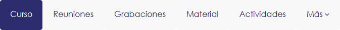

# Pruebas realizadas y límites

## Prueba manual de uso reportada

El responsable del despliegue reportó pruebas manuales satisfactorias en **un par de cursos de Moodle** del entorno institucional:

- Incorporación de alumnos al equipo de Microsoft Teams al sincronizar las matrículas.
- Retirada de alumnos del equipo tras desmatricularlos del curso de Moodle.
- Aparición de las pestañas **Reuniones**, **Grabaciones** y **Material** con sus vínculos.

**No se ha probado el uso de forma masiva.** Estos resultados no permiten afirmar capacidad, rendimiento ni fiabilidad para grandes cantidades de cursos o alumnos. Tampoco acreditan todos los casos de error, concurrencia o interrupciones de Microsoft Graph.

Esta evidencia fue reportada por el operador: no es una ejecución automatizada ni una verificación independiente de esos casos en el entorno institucional. No se publican datos de alumnos ni identificadores de la institución.



La captura aportada por el operador muestra solo las pestañas, sin el nombre ni el código del curso. Es evidencia visual de su disposición, no una prueba de altas, bajas o carga.

## Pruebas automatizadas offline

**No se ha acreditado una suite completa.** Tras restablecer Docker externamente, se ejecutó una vez el subconjunto portable con la imagen fijada: cinco archivos de pruebas terminaron con código 0 (20 casos del parser, 9 del CLI, 3 grupos del planificador, 10 del almacenamiento y 2 de navegación: 44 líneas PASS). El lint de los 51 archivos PHP terminó con código 0, sin errores de sintaxis. No fue necesario corregir código ni configuración PHP.

Los dos intentos anteriores habían terminado con código 1 antes de iniciar PHP por falta del motor Linux; quedan sustituidos como evidencia de ejecución por esta comprobación. No se arrancaron servicios de aplicación, no se montaron datos externos y no se descargaron imágenes.

## Subconjunto autocontenido

Estas cinco pruebas existentes usan código de esta carpeta, fixtures sintéticos y dobles en memoria; no necesitan Moodle instalado ni ZIP externos:

- `teamscsv/tests/parser_standalone.php`: formato y límites del CSV.
- `teamscsv/tests/cache_cli_standalone.php`: contrato de opciones, salida y códigos del CLI mediante un callback simulado.
- `teamscsv/tests/membership_plan_standalone.php`: planificación pura y guardas.
- `teamscsv/tests/membership_store_standalone.php`: modelo DML/XMLDB, responsabilidad, colas y actualizaciones; requiere SimpleXML. No prueba una base de datos real.
- `teamscsv/tests/navigation_priority_standalone.php`: orden y conservación de nodos con dobles; no es una prueba de navegador ni de Moodle core.

Desde la raíz de **esta distribución**, con Docker ya disponible y la imagen ya presente:

```bash
IMAGE=sha256:3560a2d28af8821b8c0ca1d03a81a68c14c9d00294314dcf6dd8d56ae3f5948b
EXPORT_ROOT="$(pwd)"
# En Git Bash de Windows, use en cambio:
# EXPORT_ROOT="$(pwd -W)"
MSYS_NO_PATHCONV=1 docker run --rm --pull=never --network none --read-only \
  --cap-drop ALL --security-opt no-new-privileges \
  --mount "type=bind,source=$EXPORT_ROOT,target=/export,readonly" \
  --workdir /export --entrypoint php "$IMAGE" teamscsv/tests/parser_standalone.php
MSYS_NO_PATHCONV=1 docker run --rm --pull=never --network none --read-only \
  --cap-drop ALL --security-opt no-new-privileges \
  --mount "type=bind,source=$EXPORT_ROOT,target=/export,readonly" \
  --workdir /export --entrypoint sh "$IMAGE" -c '
    status=0
    for test in cache_cli membership_plan membership_store navigation_priority; do
      php "teamscsv/tests/${test}_standalone.php"
      result=$?
      printf "%s: exit=%s\n" "$test" "$result"
      if [ "$result" -ne 0 ]; then status=1; fi
    done
    exit "$status"'
MSYS_NO_PATHCONV=1 docker run --rm --pull=never --network none --read-only \
  --cap-drop ALL --security-opt no-new-privileges \
  --mount "type=bind,source=$EXPORT_ROOT,target=/export,readonly" \
  --workdir /export --entrypoint sh "$IMAGE" -c '
    status=0; count=0
    for file in $(find teamscsv -name "*.php" -type f); do
      php -l "$file" || status=1
      count=$((count + 1))
    done
    printf "PHP files checked: %s\n" "$count"
    exit "$status"'
```

Cada prueba y el lint deben terminar con código 0 y sin fallos. El bucle de lint agrega los errores de PHP; presupone las rutas sin espacios del inventario actual. Los comandos no ejecutan cron, no montan configuraciones externas y no habilitan red. No sustituya la imagen fijada por una etiqueta mutable para atribuir resultados a esta preparación.

## Pruebas conservadas, no ejecutadas

| Archivos en `teamscsv/tests/` | Dependencia o motivo |
| --- | --- |
| `import_seam_standalone.php` | ZIP exacto de O365, parche y ZIP histórico 405 para comparación; rutas `/artifacts`, `/plugin`, `/scratch` |
| `membership_snapshot_standalone.php`, `membership_executor_standalone.php` | Artefacto O365 exacto y derivación de `artifact_sources()`; no son autocontenidas |
| `membership_cron_standalone.php`, `membership_task_local.php` | Fixture de artefactos; el segundo es auxiliar del primero, no un ejecutable autónomo |
| `course_tabs_standalone.php`, `link_discovery_standalone.php`, `link_publication_standalone.php`, `links_seam_standalone.php`, `tabs_storage_standalone.php`, `scan_cursor_upgrade_standalone.php` | Necesitan composición/inyección de fuentes. El compositor existente está en `membership_cron_standalone.php --preserve`, pero su arranque también requiere el artefacto O365 |
| `importer_test.php`, `link_publication_test.php` | PHPUnit de una instalación de pruebas de Moodle, ausente aquí |
| `navigation_priority_core.php` | Fuentes de Moodle core externas, ausentes aquí |

Se conservaron estos archivos para no ocultar cobertura ni alterar pruebas de dominio. No ejecute indiscriminadamente todos los PHP con sufijo `standalone`: algunos son plantillas. No se sustituyeron hashes ni fixtures históricos para fingir portabilidad. Tampoco se incluyó el comprobador externo opcional `o365_isolation_standalone.py`; la aplicación y el aislamiento del parche requieren verificación aparte.

## Evidencia que falta

La prueba manual reportada no sustituye la verificación sistemática del parche sobre su upstream exacto, integración Moodle/base de datos, Privacy API, concurrencia real, tareas de membresía con sus diagnósticos, navegación y errores de Microsoft Graph. Siguen pendientes las pruebas de uso masivo y de carga. Durante el empaquetado no se ejecutaron pruebas nuevas en producción; las pruebas manuales posteriores fueron realizadas y reportadas por el operador. El empaquetado no cambió lógica: no hay un RED significativo para esta copia/documentación; su comprobación principal es la igualdad byte a byte respecto de las fuentes seleccionadas.
