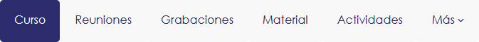

# TeamsCSV para Moodle

Plugin local para vincular cursos de Moodle con Teams existentes mediante CSV, preparar membresías administradas y mostrar enlaces de reuniones, grabaciones y material de clases.

**Versión alfa: no es una garantía de sincronización ni una validación para uso masivo.** El operador reportó altas y bajas de alumnos en Teams y pestañas con vínculos funcionando en **un par de cursos de Moodle**. No se ha probado el uso masivo ni se garantiza el comportamiento en otros entornos; consulte el alcance y las pruebas pendientes en [PRUEBAS.md](PRUEBAS.md). Este repositorio tiene historial independiente del entorno original e incluye la GPLv3 oficial y las atribuciones en [LICENCIAS.md](LICENCIAS.md).

## Pestañas del curso



Captura aportada por el operador, recortada para mostrar únicamente la navegación. Ilustra la disposición de las pestañas; no acredita por sí sola la sincronización de membresías ni el funcionamiento a gran escala.

## Compatibilidad exacta

| Componente | Requisito |
| --- | --- |
| Plugin | `local_teamscsv`, versión `2026060407` (407) |
| Release | `0.1.4-alpha`, `MATURITY_ALPHA` |
| Moodle | Mínimo declarado `2025040800`; no implica validación de todas las versiones posteriores |
| Microsoft 365 | `local_o365` **exactamente `2025040835`**, más el parche incluido y sus tres hashes exactos |

No basta con instalar una versión «igual o superior» de Microsoft 365. Aunque Moodle representa la dependencia como un mínimo, el adaptador comprueba la igualdad exacta y rechaza archivos parcheados diferentes.

## Antes de empezar

1. Lea [INSTALACION.md](INSTALACION.md) y pruebe únicamente en un entorno aislado con datos sintéticos.
2. Revise [SEGURIDAD.md](SEGURIDAD.md) y [MEMBERSHIP-SYNC.md](MEMBERSHIP-SYNC.md) antes de habilitar tareas.
3. Ejecute el subconjunto offline descrito en [PRUEBAS.md](PRUEBAS.md). No sustituye una prueba de integración.

## CSV

Encabezado literal: `course_id,team_name`. Use UTF-8, separador coma, máximo 100 registros y 1 MiB. `course_id` es el ID interno numérico positivo, sin ceros iniciales; no es el ID number del curso. Los nombres deben coincidir exactamente con la caché de Teams y no ser ambiguos.

Ejemplo exclusivamente sintético; sustituya ambos campos por datos de su laboratorio:

```csv
course_id,team_name
2,Equipo de prueba
```

La previsualización lee la caché local, no verifica el estado remoto en tiempo real. La aplicación guarda conexiones y trabajo pendiente, pero **no modifica Teams durante la importación**. No sobrescribe conexiones existentes. Excluya Teams administrados por School Data Sync (SDS).

## Contenido

- `teamscsv/`: plugin, idiomas y pruebas originales, incluidos los diagnósticos actuales de membresías.
- `patches/local_o365-managed-membership.patch`: parche obligatorio para la versión exacta de Microsoft 365.
- Documentación pública en español. Las cadenas y comentarios originales del código se conservan sin traducciones que alteren su fidelidad.

No se incluyen Moodle, Microsoft 365, credenciales, CSV reales, ZIP históricos, respaldos, registros ni herramientas de navegador. La única captura incluida muestra las pestañas, sin el nombre ni el código del curso. No hay descarga automática de fixtures ni instalación de dependencias.

## Errores y contribuciones

El repositorio está orientado a mantener parches con control de versiones y recibir propuestas de mejora mediante issues. Describa versiones exactas, resultado esperado y pasos reproducibles con datos sintéticos; consulte [SEGURIDAD.md](SEGURIDAD.md) antes de adjuntar información. Las mejoras propuestas deben conservar las guardas de compatibilidad e incluir pruebas y documentación. Para problemas del plugin Microsoft 365 sin relación con este parche, use los canales de upstream indicados en [LICENCIAS.md](LICENCIAS.md).
